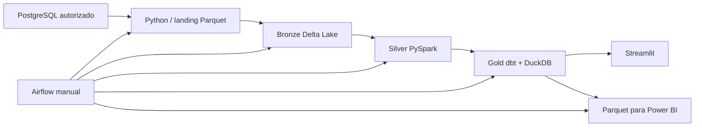

# Arquitetura e decisões

**Separação de camadas:** a ingestão preserva proveniência, a Bronze registra dados em Delta, a Silver limpa/padroniza/deduplica, e a Gold calcula indicadores em modelos SQL versionados. O painel lê a Gold em modo somente leitura. A DAG encadeia cinco tarefas e não tem agenda automática (`schedule=None`).

**Decisões explícitas:** Spark roda em contêiner para evitar dependência de `winutils` no Windows; Airflow aciona contêineres para Silver, Gold e exportação; o volume Docker mantém arquivos Delta em filesystem Linux para evitar problemas de visibilidade de arquivos no bind mount do Windows. Consulte o código e [Gold](gold.md) para os limites já documentados.

**Estado:** os arquivos de implementação existem, mas esta publicação não afirma uma execução contra fonte real nem homologa indicadores. A vitrine estática descreve o código e seus limites. Great Expectations, streaming e cloud permanecem no roadmap.
